# Library of Tomorrow

**A moody, maximalist library website for books, manga, comics, vinyl and film.**
Browse the catalog, open a description page for any item, put up to five in your bag, check out with pickup or delivery,
and manage your loans and fines from your member profile. Every click runs real SQL, and the site shows you the query.

It started as my [Java console app](java/libraryManagementSystem.java) (borrow, return, donate, show) and grew into a full-stack web app:
React on the front, SQL underneath, and PHP + MySQL when it runs on a server.


**Live demo: [carlosz98.github.io/NewLibraryManagementSite](https://carlosz98.github.io/NewLibraryManagementSite/)**
(runs entirely in your browser; your borrows and donations are saved on your device)

[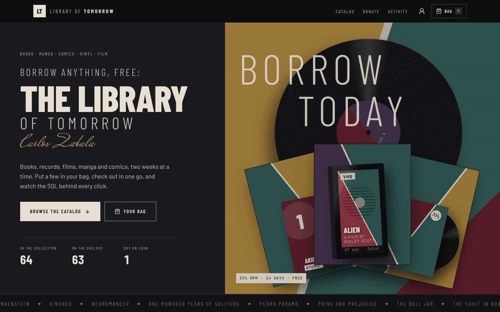](https://carlosz98.github.io/NewLibraryManagementSite/)

---

## Contents

- [Features](#features)
- [Screenshots](#screenshots)
- [Quick start](#quick-start)
- [Run it with PHP + MySQL (XAMPP)](#run-it-with-php--mysql-xampp)
- [How it works](#how-it-works)
- [Database](#database)
- [API](#api)
- [Project structure](#project-structure)
- [Tech stack](#tech-stack)
- [Deploying](#deploying)
- [Roadmap](#roadmap)
- [Credits](#credits)

---

## Features

**Catalog**
- 64 items to start: 16 books, 8 manga, 8 comics, 16 albums and 16 films, each with a year and a short description
- Filter by format with sliding tabs, search by title, creator or year, sort, and show only what's on the shelf
- Every item gets a **generated cover** in its own edition style: dust-jacket hardcovers, numbered manga volumes
  (spine on the right), single comic issues, LP sleeves with the record peeking out, and VHS boxes for films
- Call numbers in library style, like `MG MIU 0020` for Berserk

**Item pages** (`#item-20`)
- Large cover that tilts toward your pointer, facts, description and current status
- Borrow, add to bag, or return
- The item's own loan history, plus the SQL query behind it
- More by the same creator and more in the same format

**Bag and checkout**
- Collect up to 5 items, then check out together in one SQL transaction
- Pickup at the desk (free) or home delivery ($2.50 per item)
- **Demo payment** step with an animated card that flips while you type the security code

> **Payments are a demo.** Nothing is charged. Only the test card `4242 4242 4242 4242` is accepted,
> and card numbers are never saved; orders keep the total and the last four digits.

**Member profile** (`#profile`)
- A library card you can flip, with a barcode drawn from your card number
- Edit your name and email
- What you have out right now, with due dates and overdue warnings
- Overdue fines ($0.25 a day, capped at $5 per loan) that you can pay with the demo checkout
- Loan history and order history

**Everything else**
- Donate items by hand, or search **Open Library**, **MusicBrainz** and **Wikidata** and add results in one click
- Live activity log: every borrow, return, donation and order, with the exact SQL it ran
- "New arrivals" newsletter signup that saves your email to your profile
- Works on phones, keyboard friendly, and respects the system's reduce-motion setting

---

## Screenshots

| | |
|---|---|
| 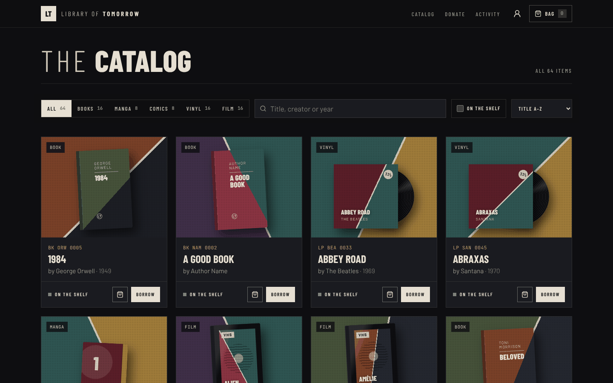 | 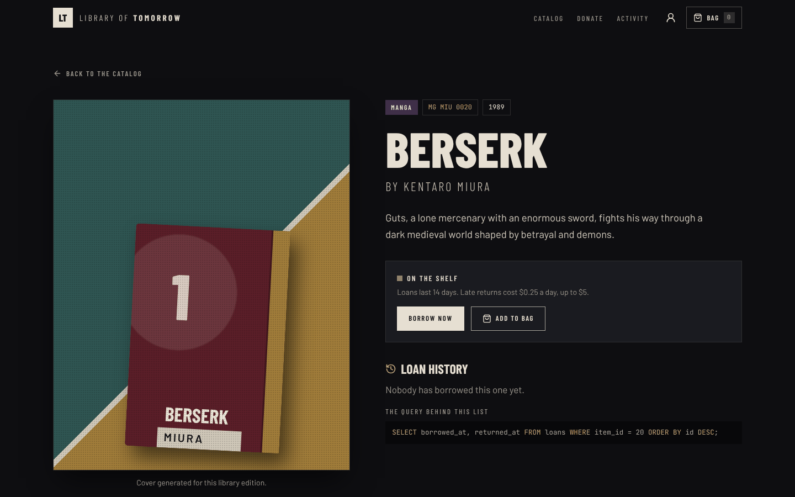 |
| **Catalog:** filter, search, sort, borrow or bag | **Item page:** description, status, loan history and SQL |
| 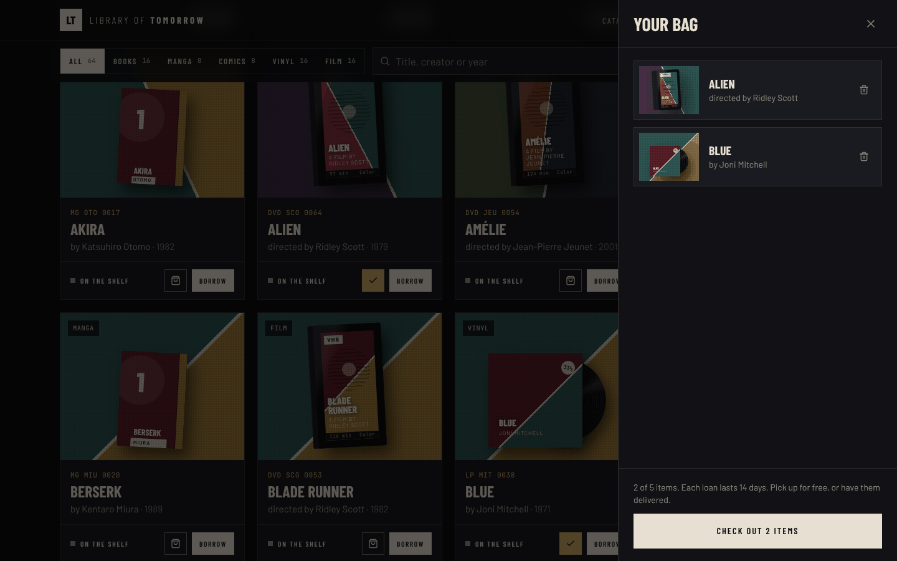 | 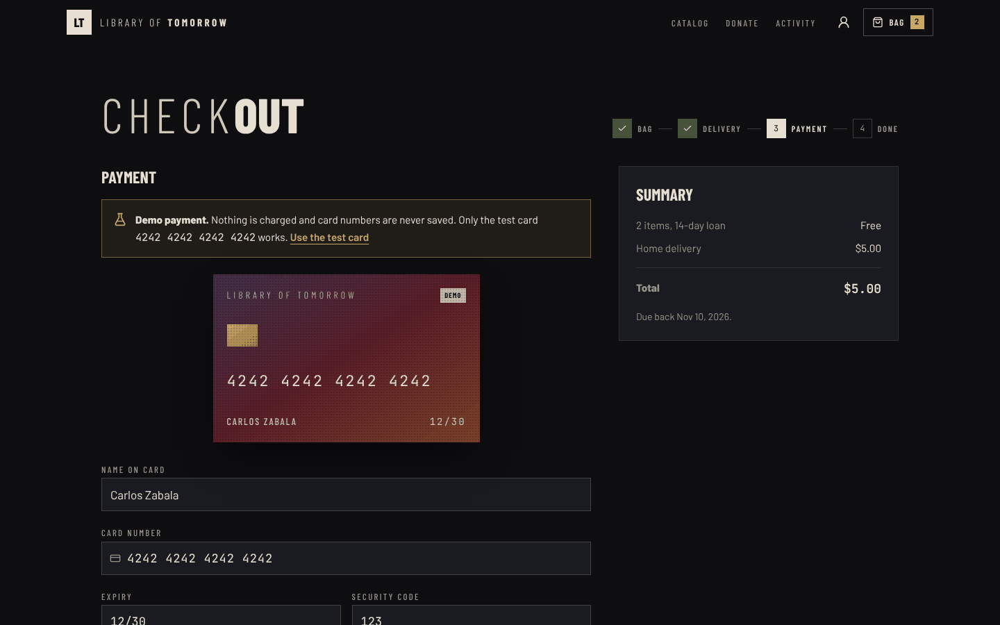 |
| **Bag:** up to 5 items, checked out together | **Checkout:** demo payment with the test card |
| 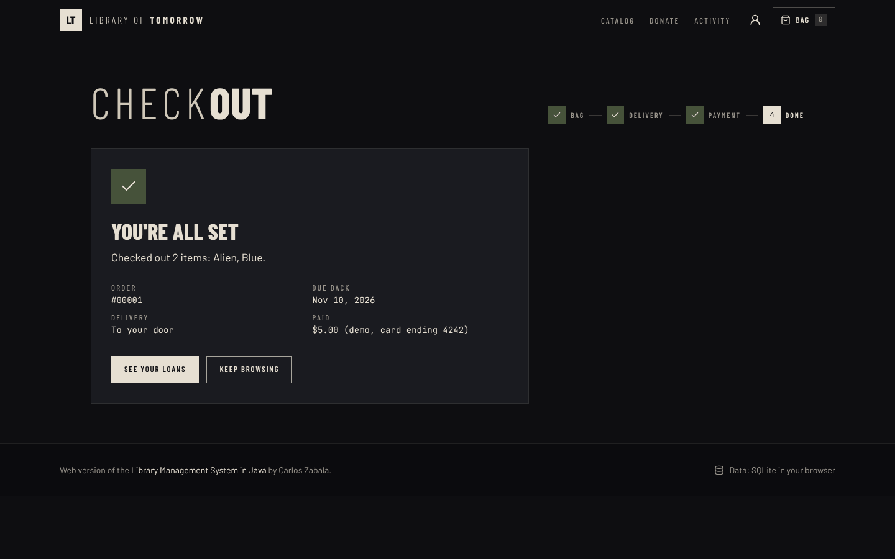 | 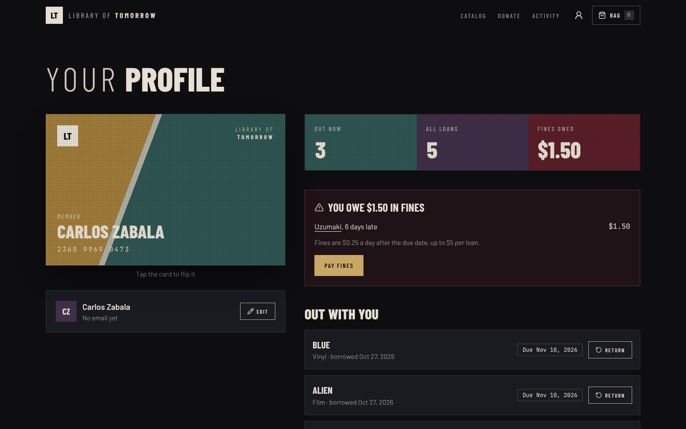 |
| **Receipt:** order number, due date, what was paid | **Profile:** library card, loans, fines, orders |
| 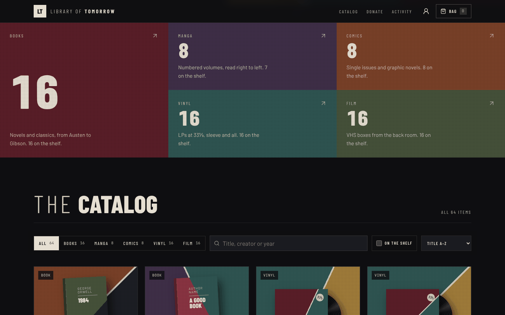 | 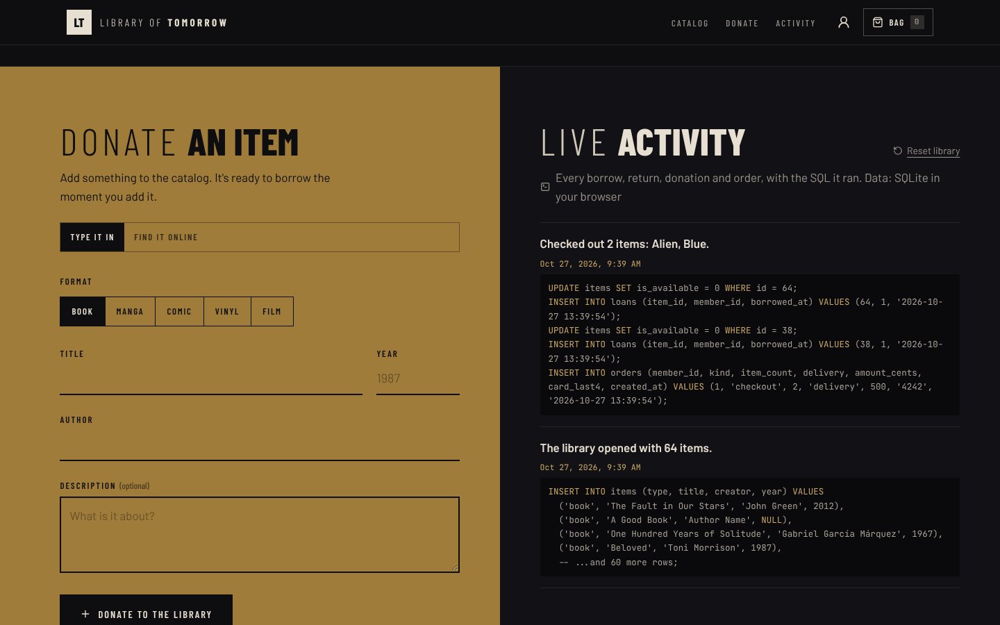 |
| **Formats:** one color block per format | **Donate and live activity**, with the SQL behind each action |

<p align="center">
  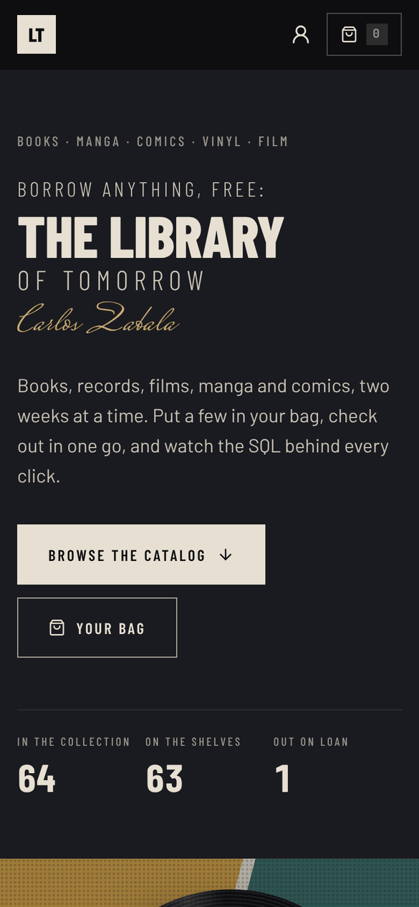
  &nbsp;&nbsp;
  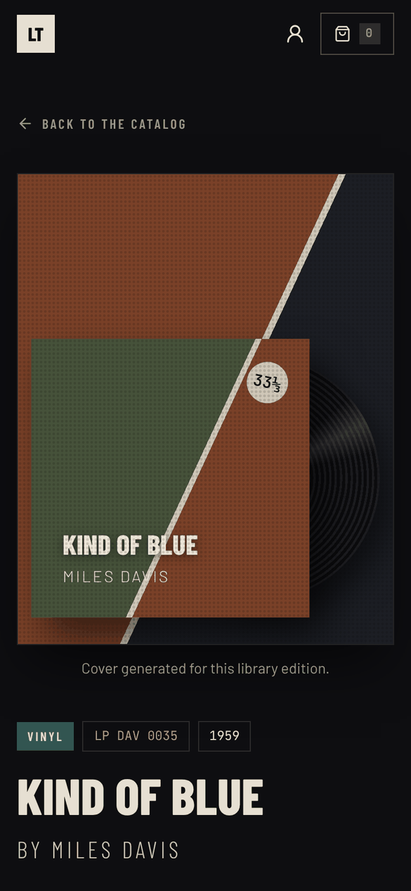
</p>

---

## Quick start

You need [Node.js](https://nodejs.org) 18 or newer.

```bash
npm install
npm run dev
```

Open the address Vite prints (usually http://localhost:5173).
In this mode the library runs on **SQLite compiled to WebAssembly, inside your browser**, so you don't need a server or a database.
Your changes are saved in the browser; **Reset library** (in Live activity) puts everything back.

| Command | What it does |
|---|---|
| `npm run dev` | Start the dev server |
| `npm run build` | Build the site into `dist/` |
| `npm run preview` | Serve the build locally |
| `npm run typecheck` | Type-check the TypeScript components |

---

## Run it with PHP + MySQL (XAMPP)

1. `npm run build`
2. Copy everything inside `dist/` into XAMPP's `htdocs/library/`.
3. Start Apache and MySQL in the XAMPP control panel.
4. In phpMyAdmin, import [`database/schema.sql`](database/schema.sql). It creates `library_db` with the 64 starting items,
   your member account and a few example loans (one is overdue, so fines have something to show).
5. Open http://localhost/library/. The footer should say **Data: PHP + MySQL**.

XAMPP's defaults (user `root`, no password) work out of the box. To use other credentials, create
`public/config.local.php` before building (it's git-ignored):

```php
<?php
return ['host' => '127.0.0.1', 'name' => 'library_db', 'user' => 'root', 'pass' => ''];
```

On a cloud host, set `DB_HOST`, `DB_PORT`, `DB_NAME`, `DB_USER` and `DB_PASS` as environment variables instead.
If you already have a database from an older version, `api.php` adds any missing tables and columns by itself.

---

## How it works

**Same OOP design as the Java version.** The model in [`src/lib/library.js`](src/lib/library.js) mirrors the original classes:

```
LibraryItem            id, title, isAvailable, callNumber, dueDate
├── Book               author
├── Manga              author
├── Comic              writer
├── Vinyl              artist
└── Movie              director
```

**Two interchangeable data stores** with the same methods (`allItems`, `itemDetail`, `borrow`, `giveBack`, `donate`,
`checkout`, `payFines`, `profile`, `updateProfile`, `reset`):

| Store | Used when | Data lives in |
|---|---|---|
| `ApiStore` | the site is served by PHP | MySQL / MariaDB through `public/api.php` |
| `BrowserStore` | static hosting, GitHub Pages, `npm run dev` | SQLite (sql.js, WebAssembly) saved in the browser |

When the page loads it asks `api.php` for a ping. If PHP answers, it uses MySQL; otherwise it falls back to the browser database.
Both run the same SQL against the same tables, and every write is recorded in `activity` with the statement it ran.
The messages match the Java version's output, like `Abbey Road has been borrowed.`

---

## Database

Defined in [`database/schema.sql`](database/schema.sql). Safe to import more than once.

| Table | Holds |
|---|---|
| `items` | Every book, manga, comic, album and film: `type`, `title`, `creator`, `year`, `description`, `is_available` |
| `loans` | One row per borrow: `borrowed_at`, `returned_at`, `member_id`, `fine_paid_cents` |
| `members` | The library member: name, email, card number |
| `orders` | Checkouts and fine payments: item count, delivery, amount, card's last four digits |
| `activity` | The live log: message + the SQL that ran |

`items` uses **single table inheritance**: the five subclasses share one table, and `type` says which one a row is.

The end of `schema.sql` has practice queries to try in phpMyAdmin: what's on the shelf, counts per format,
what's overdue and the fines owed, the most-borrowed items, and orders.

```sql
-- overdue loans and their fines ($0.25 a day, capped at $5)
SELECT i.title,
       DATEDIFF(UTC_TIMESTAMP(), l.borrowed_at + INTERVAL 14 DAY) AS days_late,
       LEAST(DATEDIFF(UTC_TIMESTAMP(), l.borrowed_at + INTERVAL 14 DAY) * 25, 500) / 100 AS fine_dollars
FROM loans l JOIN items i ON i.id = l.item_id
WHERE l.returned_at IS NULL AND UTC_TIMESTAMP() > l.borrowed_at + INTERVAL 14 DAY;
```

---

## API

`public/api.php` is a small JSON API using PDO prepared statements.

| Method | Endpoint | Body | Returns |
|---|---|---|---|
| GET | `api.php?action=ping` | | `{ ok }` |
| GET | `api.php?action=items` | | `{ items }` |
| GET | `api.php?action=item&id=20` | | `{ item, loans, sql }` |
| GET | `api.php?action=activity` | | `{ activity }` |
| GET | `api.php?action=profile` | | `{ member, loans, orders }` |
| POST | `api.php?action=borrow` | `{ id }` | `{ message }` |
| POST | `api.php?action=return` | `{ id }` | `{ message }` |
| POST | `api.php?action=donate` | `{ type, title, creator, year?, description? }` | `{ message }` |
| POST | `api.php?action=checkout` | `{ ids, delivery, cardNumber? }` | `{ message, orderId, borrowed, amountCents, dueDate }` |
| POST | `api.php?action=pay_fines` | `{ cardNumber }` | `{ message }` |
| POST | `api.php?action=profile_update` | `{ name, email }` | `{ message }` |
| POST | `api.php?action=reset` | `{}` | `{ message }` |

Problems you can fix (an empty bag, the wrong test card, a missing title) come back as `422` with a plain message.

`public/lookup.php` proxies the online catalogs for "Find it online", sending the User-Agent MusicBrainz asks for
and keeping to its one-request-per-second limit.

---

## Project structure

```
index.html                    page shell
src/
  main.jsx                    entry: fonts, MotionConfig, App
  App.jsx                     routes (#item-ID, #checkout, #profile) and the home page
  index.css                   base styles, design tokens, generated cover CSS
  lib/library.js              classes, both data stores, all the SQL, online catalogs
  lib/utils.js                cn(), cover colors, dates, SQL highlighting, safe storage
  hooks/useLibrary.jsx        app state: items, activity, bag, toasts, actions
  hooks/useRoute.js           hash routing
  components/                 Navbar, Hero, FormatBento, Catalog, ItemCard, Cover, BagSheet,
                              PaymentForm, DonatePanel, ActivityLog, NewsletterBand, Footer
  components/ui/              Button, SegmentedControl, NumberTicker, SpotlightCard, Marquee,
                              Sheet, Toaster, newsletter-signup-ticket (+ shadcn button, input, card)
  pages/                      ItemPage, CheckoutPage, ProfilePage
public/                       copied as-is into the build
  api.php                     JSON API
  lookup.php                  online catalog proxy
  config.php                  database settings
  seed.json                   starting collection, member and example loans
database/schema.sql           MySQL tables, starting data and practice queries
java/                         the original Java console app
screenshots/                  images for this README
```

---

## Tech stack

| Layer | Tools |
|---|---|
| Front end | React 18, Vite 5, Tailwind CSS 3, framer-motion 11, lucide-react icons |
| Components | shadcn / 21st.dev style, in `src/components/ui/` (TypeScript where they came from 21st.dev) |
| Data in the browser | sql.js: SQLite compiled to WebAssembly |
| Server | PHP 8 with PDO, MySQL 8 or MariaDB |
| Fonts | Barlow Condensed, Barlow, JetBrains Mono, Mrs Saint Delafield, bundled with Fontsource |
| Online catalogs | Open Library (books, manga, comics), MusicBrainz (albums), Wikidata (films) |

**Animation (framer-motion):** the hero's entrance sequence and scroll-linked headline, pointer-following tilt on covers,
tabs with a sliding highlight (`layoutId`), grid items that animate in and out as you filter, count-up numbers,
the bag drawer, toasts, flipping cards and the receipt burst. All of it follows the visitor's reduce-motion setting.

**Design:** gloomy maximalism. Deep charcoal, bone text, and muted jewel blocks (ochre, teal, oxblood, plum, moss, rust),
with thin wide-tracked caps next to heavy condensed caps. The type pairing and accessibility rules follow the
UI/UX Pro Max design guidelines.

---

## Deploying

**GitHub Pages (live demo).** [`.github/workflows/deploy.yml`](.github/workflows/deploy.yml) builds the site on every push
to `main` and publishes it to the `gh-pages` branch. One-time setup: **Settings → Pages → Build and deployment →
Deploy from a branch → `gh-pages` / `(root)`**. The site is then live at
https://carlosz98.github.io/NewLibraryManagementSite/. PHP doesn't run on Pages, so the site uses the in-browser database
there; "Find it online" works.

**PHP host (MySQL).** Upload the contents of `dist/` to any host with PHP 8, import `database/schema.sql` into its MySQL,
and set the database environment variables (or `config.local.php`).

---

## Roadmap

- [ ] Put the PHP + MySQL version in the cloud (managed MySQL + Render or Railway)
- [ ] Member sign-in, so more than one person can have a profile
- [ ] Holds: reserve an item that's out on loan
- [ ] A Spring Boot backend to sit alongside `api.php`, using the same tables
- [ ] Rebuild the Java console app on one `ArrayList<LibraryItem>`, with `Manga` and `Comic` subclasses

---

## Credits

- Original Java console app and this web version by **Carlos Zabala**:
  [GitHub](https://github.com/carlosz98) · [LinkedIn](https://www.linkedin.com/in/carloszabala98/)
- Design guidance: [UI/UX Pro Max](https://github.com/nextlevelbuilder/ui-ux-pro-max-skill) (MIT)
- Newsletter ticket component from [21st.dev](https://21st.dev), built on [shadcn/ui](https://ui.shadcn.com)
- [sql.js](https://github.com/sql-js/sql.js) (MIT) for SQLite in the browser
- Fonts via [Fontsource](https://fontsource.org), under the SIL Open Font License
- Catalog search: [Open Library](https://openlibrary.org/developers/api), [MusicBrainz](https://musicbrainz.org/doc/MusicBrainz_API),
  [Wikidata](https://www.wikidata.org/wiki/Wikidata:Data_access)

Covers in the app are generated for this project; no album, book or film artwork is used.
Item descriptions are short original summaries written for this library.
